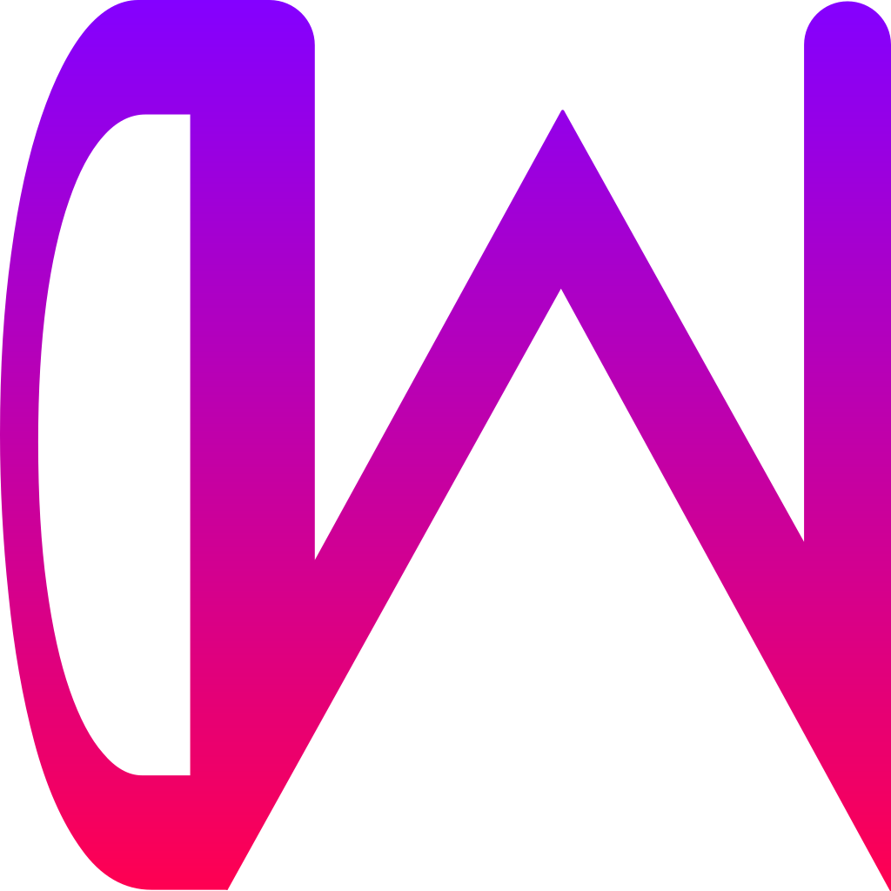

<p align="center">
  
</p>

<h1 align="center">MIDIDAW</h1>

<p align="center">
  <strong>Turn your phone or tablet into a low-latency MIDI controller for any Digital Audio Workstation (DAW).</strong>
</p>

<p align="center">
  <a href="https://github.com/ajaysaagar-dev/mididaw/stargazers"></a>
  <a href="https://github.com/ajaysaagar-dev/mididaw/releases"></a>
  <a href="https://github.com/ajaysaagar-dev/mididaw/blob/main/LICENSE"></a>
  
  
</p>

<p align="center">
  <a href="#-key-features">Features</a> •
  <a href="#-connection-modes">Connection Modes</a> •
  <a href="#-supported-daws">Supported DAWs</a> •
  <a href="#-quick-start">Quick Start</a> •
  <a href="#-pc-bridge-app">PC Bridge</a> •
  <a href="https://ajaysaagar-dev.github.io/mididaw/">Live Website</a>
</p>

---

## 🎹 Overview

**MIDIDAW** is an open-source, ultra-responsive mobile MIDI control surface and virtual hardware bridge designed for modern music producers, beatmakers, and sound designers. It transforms your Android device into a physical touch MIDI controller that integrates seamlessly into your PC or Mac production setup with **sub-millisecond latency**.

Whether you are producing in the studio with a USB cable or performing wirelessly across your local network, MIDIDAW gives you instant access to expressive scales, drum pads, pitch ribbons, and DAW transport controls.

---

## ✨ Key Features

### 🎹 1. Intelligent Scale Keyboard
- **16+ Scale Quantization Modes**: Major, Natural Minor, Harmonic Minor, Dorian, Phrygian, Lydian, Mixolydian, Pentatonic, Blues, and exotic modes. Never hit a wrong note while composing melodies.
- **Dynamic Octave Shifter & Transpose**: Fast octave navigation (-2 to +8 octaves).
- **Pitch Bend & Modulation**: Smooth multi-touch capacitive ribbons for expressive synth solos and automation.

### 🥁 2. Velocity-Sensitive Drum Pads
- **MPC-Style Touch Grid**: Fast finger-drumming layout with sub-millisecond trigger response.
- **Custom Pad Mapping**: Map individual pads to custom MIDI note numbers, octave registers, and MIDI channels (1-16).
- **Haptic Feedback**: Physical tactile vibration response on trigger for realistic finger-drumming feel.

### 🎛️ 3. Continuous Slide Roll Ribbon
- **Microtonal Glissando**: Smooth continuous ribbon surface for expressive fretless glide and synth modulation.
- **Multi-Touch Expression**: Modulate CC parameters and cutoff filters simultaneously while sliding.

### ⚡ 4. Dual High-Speed Connection Modes
- **Direct USB Hardware MIDI (Zero-Driver Mode)**: Use your phone as a native USB MIDI class-compliant device. No companion app or virtual cable required on PC.
- **High-Speed PC Bridge (WebSocket over USB ADB or Wi-Fi)**: Companion desktop app forwarding binary MIDI packets with zero jitter and live signal monitoring.

---

## 🎚️ Supported DAWs

MIDIDAW functions as a standard hardware MIDI device or virtual loopback controller, making it compatible with all major music production software:

- **FL Studio** (Native plug-and-play detection)
- **Ableton Live** (Direct MIDI In / Control Surface mapping)
- **Cockos Reaper**
- **Apple Logic Pro** (via Network MIDI / USB)
- **Steinberg Cubase / Nuendo**
- **PreSonus Studio One**
- **Bitwig Studio**
- **Reason Studios**
- **Cakewalk by BandLab**
- **Native Instruments Maschine & Kontakt**

---

## 🔌 Connection Modes

### Method 1: Direct USB MIDI (No PC Software Needed!)

Connect directly as a class-compliant USB MIDI hardware device:

1. Connect your Android phone to your PC via a USB cable.
2. In the Android notification dropdown, tap **"Charging this device via USB"**.
3. Select **MIDI** under USB Preferences.
4. Open your DAW (FL Studio / Ableton) -> **MIDI Settings** -> Enable **Android / USB MIDI Device**.
5. In MIDIDAW, tap **USB** on the top navigation bar. Start playing!

---

### Method 2: MIDIDAW PC Bridge EXE (Wi-Fi or USB ADB Forwarding)

For wireless freedom or optimized ADB port forwarding on Windows:

1. Download or launch the standalone Windows bridge:
   ```
   pc-bridge/MidiDawBridge.exe
   ```
2. The bridge GUI will automatically:
   - Detect ADB and set up reverse port forwarding (`127.0.0.1:8080`).
   - Display your local Wi-Fi IP address (e.g., `192.168.1.50:8080`).
   - Create a virtual MIDI loopback port directly into your DAW.
3. In the mobile app, tap **Bridge** -> Select **Wi-Fi** or **USB** -> Tap **Connect**.
4. The status turns green (**Connected**) and all notes stream in real time.

---

## 🛠️ Project Structure

```bash
mididaw/
├── src/
│   ├── app/                 # Expo Router file-based screens
│   │   ├── (tabs)/
│   │   │   ├── index.tsx    # Piano Keys & Scale Quantizer
│   │   │   ├── drums.tsx    # MPC Drum Pads Grid
│   │   │   └── slideroll.tsx# Expressive Continuous Ribbon
│   ├── components/          # Reusable UI components & modals
│   ├── constants/           # Scale definitions & MIDI note tables
│   └── services/            # Low-latency MidiService & WebSocket client
├── pc-bridge/               # Windows PC Bridge Application
│   ├── bridge_gui.py        # Tkinter desktop GUI & MIDI forwarder
│   ├── MidiDawBridge.exe    # Compiled standalone Windows executable
│   └── platform-tools/      # Bundled lightweight ADB tools
└── docs/                    # GitHub Pages SEO Landing Page
```

---

## 🚀 Development & Contributing

### Prerequisites
- Node.js (v18+)
- Expo CLI (`npm install -g expo-cli`)
- Python 3.10+ (for building PC bridge)

### Mobile App Setup
```bash
# Clone the repository
git clone https://github.com/ajaysaagar-dev/mididaw.git
cd mididaw

# Install dependencies
npm install

# Start Expo development server
npx expo start
```

### PC Bridge Setup
```bash
cd pc-bridge
pip install -r requirements.txt
python bridge_gui.py
```

---

## 📄 License

This project is licensed under the MIT License — see the [LICENSE](LICENSE) file for details.

---

<p align="center">
  Built with ❤️ for music producers worldwide. Star ⭐ this repository if you find it useful!
</p>
